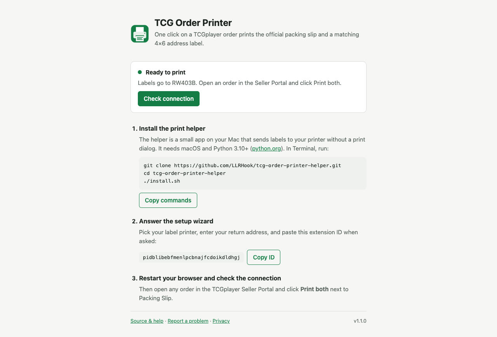

# TCG Order Printer

A Chrome extension for TCGplayer sellers. One click on an order page prints the **official packing slip and a matching 4×6 address label** straight to your label printer, with no print dialog, no saving files and no copying addresses.



## How it works

1. Open an order in the TCGplayer Seller Portal and click **Print both** next to *Packing Slip*.
2. The extension triggers TCGplayer's own **Print Default** export and captures the PDF in memory.
3. The local [print helper](https://github.com/LLRHook/tcg-order-printer-helper) checks the slip is for that exact order, lays out an address label with your return address, and prints both.

Repeated clicks during a request export only one slip, and a slip for a different order is refused. Changing orders before handoff cancels the request. If the helper does not confirm the exact order and request, check the printer queue before retrying.

## Setup

1. Install the extension. A setup page opens automatically (you can reopen it from **Setup** in the toolbar popup).
2. Install the print helper (macOS):
   ```sh
   git clone https://github.com/LLRHook/tcg-order-printer-helper.git
   cd tcg-order-printer-helper
   ./install.sh
   ```
3. In the wizard, pick your label printer, enter your return address and paste the extension ID shown on the setup page.
4. Restart the browser and click **Check connection**.

The connection check requires helper protocol version 2 and a configured printer. Failures show a specific next step:

| Problem | Fix |
|---------|-----|
| Helper missing or outdated | Run `./install.sh` in the current helper folder, restart the browser, then check again. |
| Extension not allowed | Re-run the helper wizard with the ID shown on Setup, then restart the browser. |
| Printer or return address missing | Complete that field in the helper wizard, then check again. |
| Printer unavailable | Reconnect the printer or choose an available queue in the wizard. |
| Previous submission or unexpected acknowledgement | Check the printer queue before retrying. The job may already have been submitted. |

Errors appear beside **Print both** and in the popup. Setup also shows the stable error code. Raw helper diagnostics are kept out of the interface. A slip saved to disk is never used as a print input; refresh the order page and try the capture again.

Works in Chrome, Edge, Brave, Arc, Vivaldi, Chromium and Helium on macOS with any CUPS printer that takes 4×6 labels (tested on a Munbyn RW403B).

## Privacy

Order data stays on your computer. See [PRIVACY.md](PRIVACY.md).

## Development

```sh
node --version        # Node 22, matching CI
npm test              # unit tests (node:test)
npm run e2e           # isolated browser/native-host tests (prints nothing)
npm run package       # dist/tcg-order-printer-<version>.zip for the Chrome Web Store
```

The browser tests use the existing Playwright dependency and an already cached Chromium executable. To use another installed Chromium build that supports loading unpacked extensions, set `TCG_E2E_BROWSER` to its executable path. The test does not download a browser or install the real helper.

Each browser run creates a temporary HOME, profile and native-host registration pointing only to a synthetic stub. The suite verifies that this stub receives a framed connection probe before allowing any print-request tests. The stub has no printing capability. All Seller Portal pages, orders and slips are synthetic, and external requests are blocked. Coverage includes malformed fields, mismatched slips, double clicks, navigation during the connection check or export, helper refusal codes, unrelated acknowledgements and a slip saved to temporary disk. These tests verify the extension and native-message contract; they do not prove real helper installation, CUPS operation or physical printing.

Load the folder unpacked at `chrome://extensions` (Developer mode). The manifest `key` pins the development ID to `pidblibebfmenlpcbnajfcdoikdldhgj`; the package script strips it because the Web Store assigns its own ID.

| File | Role |
|------|------|
| `pdf-bridge.js` | Main-world script that captures the PDF bytes from TCGplayer's own export |
| `content.js` | Adds the button, drives the native export, relays the PDF |
| `background.js` | Validates the sender and order, talks to the native helper |
| `setup.html` | First-run setup and connection check |

## Issues

Bug reports and feature requests: [GitHub issues](https://github.com/LLRHook/tcg-order-printer/issues). Please never attach real packing slips: they contain buyer addresses.

## License

MIT. Not affiliated with or endorsed by TCGplayer.
