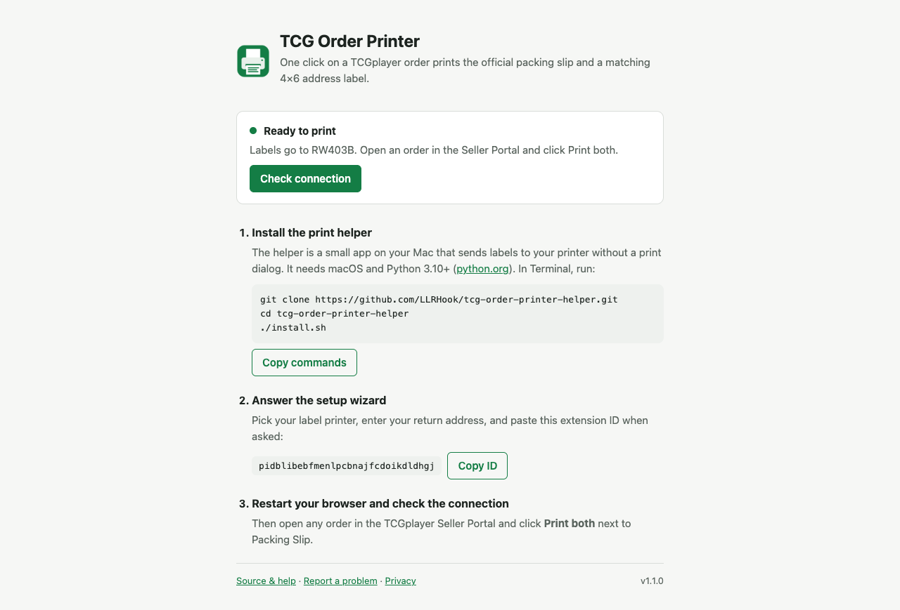

# TCG Order Printer

A Chrome extension for TCGplayer sellers. One click on an order page prints the **official packing slip and a matching 4×6 address label** straight to your label printer, with no print dialog, no saving files and no copying addresses.



## How it works

1. Open an order in the TCGplayer Seller Portal and click **Print both** next to *Packing Slip*.
2. The extension triggers TCGplayer's own **Print Default** export and captures the PDF in memory.
3. The local [print helper](https://github.com/LLRHook/tcg-order-printer-helper) checks the slip is for that exact order, lays out an address label with your return address, and prints both.

Clicking twice never double-prints the same click, and a slip for a different order is refused.

## Setup

1. Install the extension. A setup page opens automatically (you can reopen it from **Setup** in the toolbar popup).
2. Install the print helper (macOS):
   ```sh
   git clone https://github.com/LLRHook/tcg-order-printer-helper.git
   cd tcg-order-printer-helper
   ./install.sh
   ```
3. In the wizard, pick your label printer, enter your return address and paste the extension ID shown on the setup page.
4. Restart the browser and click **Check connection**.

Works in Chrome, Edge, Brave, Arc, Vivaldi, Chromium and Helium on macOS with any CUPS printer that takes 4×6 labels (tested on a Munbyn RW403B).

## Privacy

Order data stays on your computer. See [PRIVACY.md](PRIVACY.md).

## Development

```sh
npm test              # unit tests (node:test)
npm run e2e           # browser test against the installed helper (prints nothing)
npm run package       # dist/tcg-order-printer-<version>.zip for the Chrome Web Store
```

Load the folder unpacked at `chrome://extensions` (Developer mode). The manifest `key` pins the development ID to `pidblibebfmenlpcbnajfcdoikdldhgj`; the package script strips it because the Web Store assigns its own ID.

| File | Role |
|------|------|
| `pdf-bridge.js` | Main-world script that captures the PDF bytes from TCGplayer's own export |
| `content.js` | Adds the button, drives the native export, relays the PDF |
| `background.js` | Validates the sender and order, talks to the native helper |
| `setup.html` | First-run setup and connection check |

## Issues

Bug reports and feature requests: [GitHub issues](https://github.com/LLRHook/tcg-order-printer/issues). Please never attach real packing slips: they contain buyer addresses.

## License

MIT. Not affiliated with or endorsed by TCGplayer.
